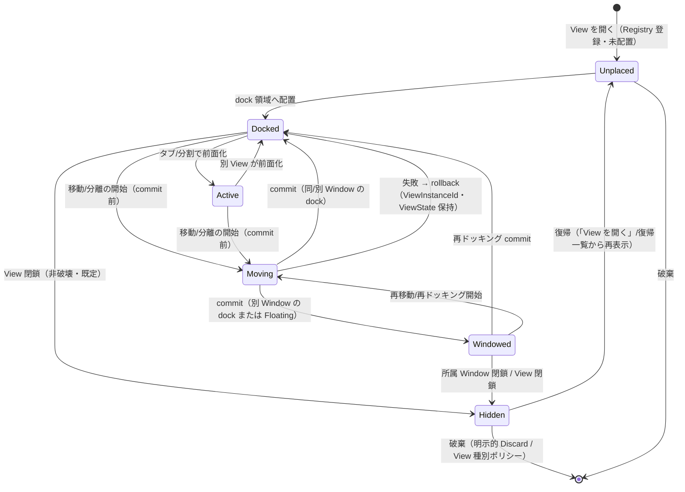
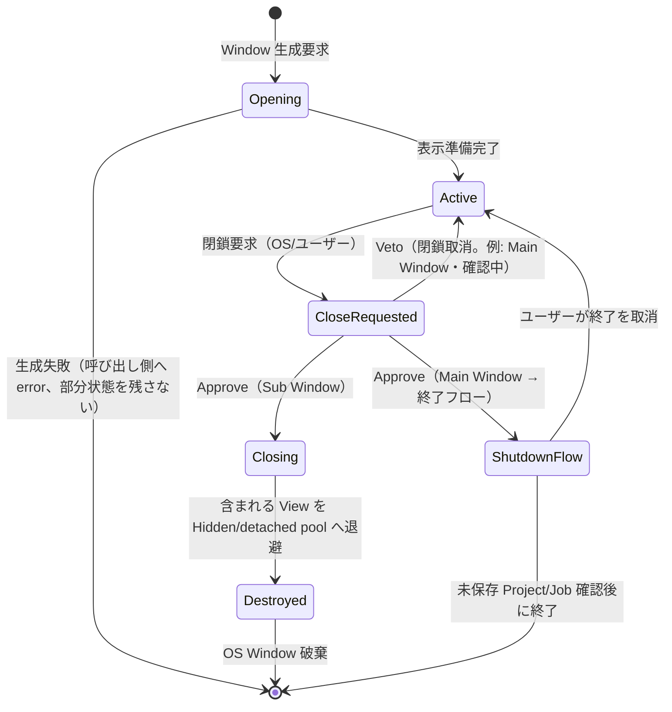
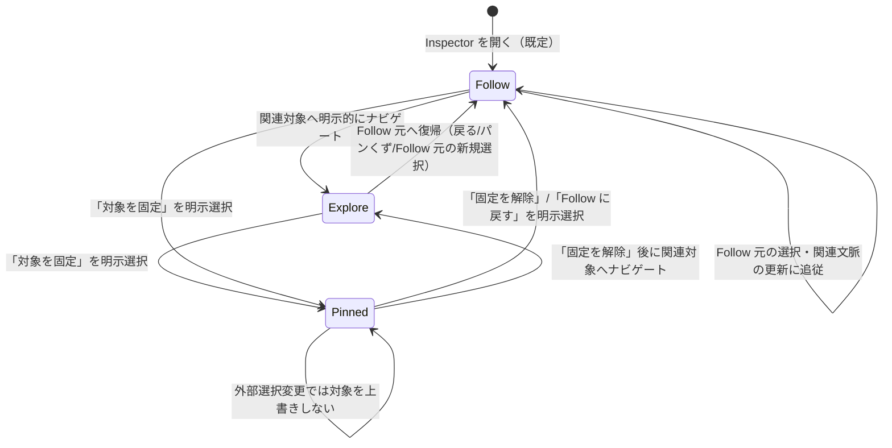
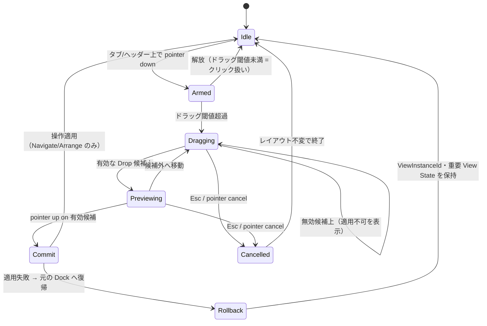
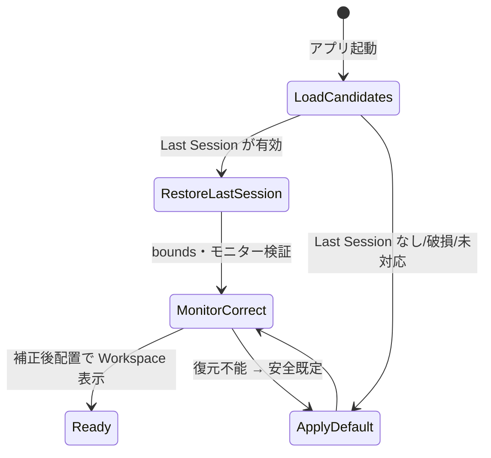

# Workspace UX 操作仕様 — Docking/Window・View 閉鎖/Inspector/Link Group/入力境界/Layout 復帰 (Issue #3 正本)

> 本書は Synvelis Issue #3 の **製品 UX 正本**である。ここで「規定」
> 「必須」と記すのはユーザー操作の規範であり、実装・実 OS 検証の
> 完了を意味しない。設計レビュー評価を実 Window の Pass に換算
> しない（POLICIES.md §2/§3、Issue #3 明示禁止）。状態遷移・
> 操作表・Expected Oracle は後続の headless / gpui-test / real-OS
> 各レーンの検証対象として固定する。

## 1. Context

「Create → Understand → Refine」をドッキング可能な複数 Window /
複数モニター環境でも予測可能に成立させるための、Workspace 共通
インタラクション仕様。上位の統合設計
`docs/designs/workspace-docking-state-architecture.md`（以下「統合
設計」）が論理構造・状態正本・Command 契約を定め、WS-A（#36）と
ED-A（#38）が headless でその契約を固定した。本書はその上に
**ユーザーが実際に行う操作と観測できる結果**を一意に規定する
文書層であり、実装方式・型名・描画詳細は持たない。

前提となる既存契約（本書はこれらを再定義しない）:

- `ViewInstanceId` / `WindowId` / `DockTree` / `WorkspaceSession` の
  論理モデルと不変条件（統合設計 §2〜§3、Ruviform #181/#182）。
- Editing Selection / Inspection Focus / Linked Context / Active
  View / Input Focus / Native Window Focus の概念分離（統合設計
  §5.1、WS-A 実装済み）。
- Command の発行時確定 Target・入力境界優先・曖昧な破壊的
  コマンドの no-op（統合設計 §6、WS-A-03 で headless 固定済み）。
- `LayoutSnapshot` / `WorkspaceSnapshot` の versioned 永続化と
  破損・モニター欠落時の安全復元（WS-A-04、SV-GPUI-03 preset 系）。
- Tool / Gesture / Snap / Transaction の編集契約（ED-A、#11 詳細
  は別 Issue）。

## 2. Scope

### In Scope

- Docking 操作体系: ドラッグ・Drop Preview・キャンセル・失敗復帰・
  メニュー/コマンドによる代替経路・Split 調整。
- Window / View の開閉意味論: 4 種の閉鎖操作、View 破棄/非表示、
  「閉じた Window を再表示」。
- Context Inspector: Follow / Explore / Pinned の状態機械、履歴、
  選択変更時の挙動、ヘッダー UI 要素。
- Link Group / Linked Context: UI 表示・設定・同期範囲・非同期
  ケース。
- 入力境界: Focus / Keyboard / Context Menu / IME / Plugin GUI、
  Tool ジェスチャとの境界、状態×ショートカット発火表。
- Layout 永続化: Default / Saved / Last Session / Workspace
  Preset の関係、モニター欠落・画面外復帰。
- 代表シナリオ WUX-SCN-A〜F の手順・Expected Oracle・検証レーン。
- Decision Log・Owner 境界・未決定事項の分離記録。

### Out of Scope

- `crates/` の実装、画面構成（#112）、Dock 実装の変更（#113 は
  closed、後続修正は各 Owner の Issue）。
- Inspector の情報階層・Provider・Probe 連携の詳細（#5）。
- Tool/Selection/Snap/Gesture/Transaction の編集意味論詳細（#11、
  ED-A が headless 固定済みの範囲を超える確定）。
- Recording / Take / Comping との操作連携詳細（#12 — 本書は
  「録音中の Capture Target を UI 遷移が変更しない」境界のみ規定）。
- Ruviform の Window/Dock/NativeSurface 契約（#181/#182/#386/
  #388 が Owner）。製品固有の選択・調査・編集規則を Ruviform へ
  持ち込まない。
- 実 OS Window / 実 Plugin GUI / 実機モニター構成での検証
  （#114/#176 lane、現時点では NotRun）。

## 3. Components and Boundaries

本書が扱う UX 要素と、その責務境界（実装 Owner を併記）。

| UX 要素 | 本書で規定する責務 | 実装/契約 Owner |
| --- | --- | --- |
| Dock 操作面（タブ・ヘッダー・Drop Preview・Splitter） | 操作起点・Preview・確定/取消・失敗復帰の規則 | Ruviform `ruviform-ui::dock`（#182）+ Synvelis app/dock op 層（#113 系） |
| Window（Main / Sub） | 開閉要求の意味・復帰導線・終了フロー | Ruviform `ruviform-ui::window`（#181/#386）+ Synvelis WorkspaceManager |
| View（Arrangement/Mixer/Inspector/Signal Flow/Plugin Dock 等） | 閉鎖時の破棄/非表示・状態保持・復帰 | Synvelis `synvelis-workspace`（WS-A）+ 画面実装（#112） |
| Context Inspector | Follow/Explore/Pinned・履歴・ヘッダー UI | 本書が UX 正本、情報階層詳細は #5 |
| Link Group / Linked Context | 所属 UI・同期範囲・非同期ケース | `LinkGroupManager`（WS-A）+ 画面表示（#112） |
| Command / 入力境界 | フォーカス優先・対象確定・誤発火防止 | `CommandRouter`（WS-A）+ OS/Plugin 入力契約（Ruviform #386/#388、実機 #114/#176） |
| Layout 永続化 | Default/Saved/Last Session/Preset の区別・復帰 | `WorkspaceSnapshot`/`WorkspacePreset`（WS-A/SV-GPUI-03）+ 保存先（ユーザー環境設定） |

### 操作分類の原則（Issue #3 §1-2 の確定事項）

すべてのユーザー操作は次の 4 分類のいずれかに属し、一方の操作が
他方を不用意に引き起こさない。

| 分類 | 意味 | 例 | 禁止される副作用 |
| --- | --- | --- | --- |
| **Navigate** | View/Window の移動・表示切替 | Dock 移動、タブ切替、Window フォーカス | Editing Selection・Inspection Focus・Project を変更しない |
| **Inspect** | 調査対象の変更 | Inspector でノード/Bus を辿る、Linked Context のハイライト | 他 View の Editing Selection・編集コマンドを変更しない |
| **Edit** | Project データの変更 | Clip 削除、Parameter 変更、録音 Arm | 配置・フォーカスを暗黙に変えない（明示的遷移を伴う場合を除く） |
| **Arrange** | UI 配置・Layout の変更 | Dock/分割/Window 化/View 開閉、Layout Undo | Project データ・Project Undo・Transport を変更しない |

原則: **フォーカス移動 ≠ 選択変更 ≠ 調査対象変更 ≠ 編集対象
変更**（統合設計 §5.1）。本書の全規定はこの分離を前提とする。

## 4. Data and Control Flow — 状態モデルと Command 解決順序

### 4.1 View のライフサイクル

- `Hidden` は論理 View を保持した非表示状態。`ViewInstanceId`・
  `ViewStateRegistry` の状態（Editing Selection・Inspection Focus・
  viewport 等、View 種別が保持を許す範囲）は維持され、復帰時に
  回復する。描画リソース（WebView/Native Surface）は解放してよい
  — 論理状態の保持とリソース解放は分離する（Issue #3 §3）。
- `破棄` は `ViewInstanceId` の退役を意味し、復帰不能。同種 View
  を再度開くと**新しい ViewInstanceId** が発行される（複製と同じ
  扱い。移動・復帰は既存 ID を維持する — 統合設計 §3 不変条件 4）。
- `Moving` 中の View は編集ロック（headless 契約 `ViewBusy`）—
  commit/rollback 完了まで当該 View への編集コマンドは抑止される。
  Transport・他 View の編集は継続する。

### 4.2 Window のライフサイクル

- Sub Window の `CloseRequested` は **Project 終了・Job 一括取消・
  View の無言喪失を意味しない**（統合設計 §7.2、Ruviform #181 の
  CloseRequested/Destroy 分離に対応）。
- Main Window の閉鎖は Application Shutdown 要求であり、未保存
  Project・処理中 Job の確認/中止を経る別フロー。
- `Hidden` 化された View は「閉じた Window を再表示」（§6.3）で
  復帰可能。Window の閉鎖は View を Main Window へ自動再ドッキング
  しない（レイアウト破壊防止 — Issue #3 §3）。

### 4.3 Context Inspector のモード

- `Follow { source }`: 指定 View/Link Group の選択・関連文脈に追従。
- `Explore { follow_source, current, history }`: Follow 元を保持し
  つつ関連対象（接続/制御/Bus/Plugin/Parameter）へ一時移動する
  **ナビゲーション状態**。常設の独立 Workspace ではない。
- `Pinned { target }`: 指定対象を固定。他 View の選択変更で
  調査対象を上書きしない。編集は明示的な対象指定でのみ行う。

### 4.4 Dock ドラッグ状態

- `Dragging`/`Previewing` は Transient UI であり Project・Undo・
  Layout 確定状態に書き込まない。確定は `Commit` の一回のみ。
- `Rollback` は Ruviform #181/#182 の移動失敗契約に対応し、
  headless では WS-A-04 で固定済み。実機での検証は #114 lane。

### 4.5 Command / 入力の解決順序（統合設計 §6 の UX 規定）

キー・ポインター由来の操作は次の優先順位で解決する。

1. **入力境界**: OS/プラグイン固有入力、モーダル、IME 変換中、
   テキスト入力欄の捕捉中は、それらを優先し DAW コマンドを
   発火させない。
2. **Active View の View/Editing Command**: 現在の Active View で
   適用可能なコマンドを解決（対象は発行時に確定）。
3. **Transport/Project/Application Command**: 入力と衝突しない
   場合に限り解決。
4. **未解決の破壊的コマンド**: 何もしない。他 Window/View の
   古い Selection へフォールバックしない。

加えて Arrange 系操作（Dock 移動・View 開閉・Layout Undo/Redo）
は `command_kind = arrange` として Project/Editing/Transport と
別スタック・別 Undo 系統で扱う（§9.4）。

## 5. Docking 操作仕様（WUX-AC-01）

### 5.1 操作一覧

| 操作 ID | 操作 | 主な入口 | 期待効果 | 分類 |
| --- | --- | --- | --- | --- |
| WUX-DK-01 | タブ並べ替え | タブのドラッグ（同一 Tab group 内） | 順序変更のみ | Arrange |
| WUX-DK-02 | タブ化 | 他の Dock 領域中央へのドロップ | 同一 Tab group へ統合 | Arrange |
| WUX-DK-03 | 分割 | Dock 領域の上下左右端へのドロップ | 指定方向の Split 形成 | Arrange |
| WUX-DK-04 | 新 Window へ分離 | Dock 外へのタブドラッグ、またはメニュー | 同じ論理 View ID を別 Window に表示 | Arrange |
| WUX-DK-05 | 既存 Window へ移動 | 別 Window の Dock 領域へのドロップ、またはメニュー | 既存 Window の Dock Tree へ移動 | Arrange |
| WUX-DK-06 | 再ドッキング | Floating/別 Window のタブを Dock へドロップ、またはメニュー | View を Dock 配置へ戻す | Arrange |
| WUX-DK-07 | View 複製 | 「新しい View を開く」明示操作 | 同種の**新規 ViewInstanceId** を生成（移動とは別） | Arrange |
| WUX-DK-08 | Split 調整 | Splitter のドラッグ | Split 比率のみ変更（構造・所属は不変） | Arrange |
| WUX-DK-09 | View 閉鎖 | タブの閉じる操作/メニュー | §6.2 の非破壊閉鎖 | Arrange |
| WUX-DK-10 | Layout Undo/Redo | メニュー/コマンド | §9.4 の別スタックで直前の配置変更を戻す | Arrange |

### 5.2 ドラッグ開始条件と Drop Preview

- **ドラッグ開始領域はタブまたは専用ヘッダーのみ**。Arrangement の
  Clip・MIDI Note・ツールジェスチャ（Smart/Dedicated Tool の
  HitTest 領域: Handle→編集対象→Clip Body→Lane Empty→
  Background、ED-A-02）とは空間的に分離し、誤って Dock ドラッグが
  編集ジェスチャとして、またはその逆が起きない。
- ドラッグ中は **移動 View 名・ドロップ可能領域・確定後の結果**
  （タブ化/分割方向/別 Window 化）をプレビューする。無効領域は
  「適用不可」と明示し、Drop しても何も起きない（エラーにしない）。
- Drop zone の優先順位: Dock 領域中央 = タブ化、上下左右端 =
  対応方向の分割、別 Window の Dock 領域 = 移動、全 Window の
  Dock 領域外 = 別 Window 分離の候補。Drop 寸法・閾値の数値は
  §15 未決定（実機 PoC で確定）。
- 現在位置への Drop・変化を生じない Drop は no-op とし、
  Layout Undo の履歴を消費しない。

### 5.3 キャンセル・失敗・ロールバック

- `Esc` またはポインターキャンセルでドラッグを取消した場合、
  レイアウトは開始前のまま（Transient Preview のみ破棄）。
- 分離・移動の適用に失敗した場合は元の Dock に復帰し、論理
  `ViewInstanceId` と重要な View State を保持する（Ruviform
  #181/#182 契約、WS-A-04 で headless 固定済み）。
- 移動中（`Moving`）の View への編集コマンドは抑止するが、
  Project・Transport・他 View には影響しない。移動失敗で
  Project 変更・Undo・ジョブが発生することはない。

### 5.4 ドラッグ以外の代替経路（必須）

ドラッグを唯一の手段にしない。タブ/ヘッダーのコンテキスト
メニューとコマンド体系で同等操作を提供する。

| メニュー項目 | 対応操作 | 備考 |
| --- | --- | --- |
| 「新しいウィンドウへ移動」 | WUX-DK-04 | Floating/別 Window 化 |
| 「ウィンドウへ移動…」 | WUX-DK-05 | 既存 Window を列挙して選択 |
| 「左右に分割」「上下に分割」 | WUX-DK-03 | 現在位置を基準に方向分割 |
| 「タブとして結合」 | WUX-DK-02 | 現在の Tab group へ統合（対象 group の選択は実装時に確定） |
| 「新しい View を開く」 | WUX-DK-07 | 同種 View の新規インスタンス |
| 「元の位置へ戻す」 | WUX-DK-10 相当 | 直前の移動を Layout Undo で復帰 |
| 「View を閉じる」 | WUX-DK-09 | §6.2 |

- すべてのメニュー操作は Command ID を持ち、キーボード/支援
  技術から到達可能なコマンド経路を持つ（到達方法の具体的
  キー割当は #112/#113 の実装範囲）。
- 「元の位置へ戻す」は**レイアウト操作の履歴**であり、Project
  の音楽的 Undo/Redo とは別系統（Issue #3 §2）。

### 5.5 状態図

View/Window/ドラッグの状態遷移は §4.1〜4.4 の図を正本とする。
ここでは操作→状態遷移の対応を明示する。

| 操作 | 開始状態 → 終了状態 | 副作用 |
| --- | --- | --- |
| タブドラッグ確定（タブ化） | Docked/Active → 同 Tab group の非 active Tab | なし（Project/Selection 不変） |
| タブドラッグ確定（分割） | → 新 Split node の active View | なし |
| Dock 外へドロップ確定 | → 別 Window の Docked/Windowed | 新規 Window 生成を伴う場合あり |
| メニュー「新しいウィンドウへ移動」 | → Windowed | 同上 |
| Esc/キャンセル | 任意 → 開始前と同一 | なし |
| 適用失敗 | Moving → 元の Docked/Windowed（rollback） | なし（View ID/State 保持） |

## 6. Window / View 閉鎖仕様（WUX-AC-02）

### 6.1 操作区分

| 操作 | ユーザー意図 | Project への影響 | View 状態 |
| --- | --- | --- | --- |
| View を閉じる | 表示から外す | なし | 既定は Hidden（保持）。Discard は明示操作のみ |
| サブ Window を閉じる | その Window の表示を畳む | なし | 含まれる View は Hidden/detached pool で保持、復帰可能 |
| メイン Window を閉じる | アプリ終了の要求 | 未保存確認を経て終了 | 終了フローに従う |
| 最後の View を別 Window へ移す | 空になった Sub Window を畳む | なし | 移動先で View は継続、空 Window は自動閉鎖候補 |

### 6.2 View 閉鎖: 破棄と非表示の区別

| 結果 | 意味 | 復帰 | UI 表現 |
| --- | --- | --- | --- |
| **Hidden（非表示・既定）** | 表示から外すが論理 View を保持 | 「View を開く」/View 一覧から復帰。Window 閉鎖由来の View は §6.3 の Window 単位復帰。ViewState（保持を許す範囲）は回復 | 通常の「閉じる」は確認なしで Hidden |
| **Discarded（破棄）** | `ViewInstanceId` を退役させ ViewState を破棄 | 復帰不能。同種 View の再オープンは新規 ID | 「閉じて破棄」等の明示操作、または View 種別ポリシー（一時的 View 等） |

- View 閉鎖は Project Data を変更しない。Project Undo/Redo・
  revision・RT に影響しない（Arrange 分類）。
- Hidden View の描画リソースは解放してよいが、論理状態保持と
  リソース解放は分離する。復帰時に ViewState が失われないこと
  を View 種別ごとに保証する（保持しない View 種別はその旨を
  UI または文書で明示 — 詳細は #112/#5）。
- 破棄はユーザーの明示選択または View 種別の定義済みポリシー
  のみ。通常の閉鎖操作が暗黙に Discard してはならない。

### 6.3 サブ Window 閉鎖と「閉じた Window を再表示」

- Sub Window を閉じると、含まれる View は Main Window へ
  **自動再ドッキングされず**、Hidden/detached pool に保持される
  （レイアウト崩壊防止）。
- Window メニューに「閉じたウィンドウを再表示」一覧を置き、
  Window ごと（タイトル・View 数・最後のモニター情報）に復帰
  できる。復帰は最後の配置を復元し、モニター欠落時は §10.3 の
  補正に従う。
- 復元履歴の保持期間は §15 未決定（セッション内保持を既定案、
  上限・永続化は UX 検証で確定）。
- 「閉じた Window を再表示」は View を 1 つずつ Main Window へ
  戻す操作ではなく、**Window 単位で dock 構成ごと復帰**する
  操作とする（誤操作からの復旧を予測可能にするため）。

### 6.4 メイン Window 閉鎖とアプリ終了

- Main Window の閉鎖は Application Shutdown 要求。未保存
  Project・録音中/処理中 Job の確認・中止フローを経て、
  ユーザーが取消可能。Sub Window の閉鎖とは別契約
  （Ruviform #181 の CloseRequested/Destroy/Application
  Shutdown 分離に対応）。
- 終了時に Last Session Layout を保存する（§10）。
- Main Window 内の全 View を閉じてもアプリケーションは終了
  しない。終了は Main Window 閉鎖の Shutdown Flow のみ。

### 6.5 状態図

Window/View 閉鎖の状態遷移は §4.1〜4.2 を正本とする。閉鎖操作
→状態の対応:

| 操作 | 結果状態 | 復帰経路 |
| --- | --- | --- |
| View を閉じる（既定） | Hidden | View 一覧/「開く」から Unplaced 経由で再配置 |
| View を閉じて破棄 | [*]（ID 退役） | なし（新規 ViewInstanceId で再オープン） |
| Sub Window を閉じる | 各 View → Hidden、Window → Closed 記録 | 「閉じた Window を再表示」 |
| Main Window を閉じる | ShutdownFlow → 確認 → 終了 or Active | 確認ダイアログで取消 |
| Sub Window の最後の View を移動 | 空 Window → 自動閉鎖（記録なし） | 移動済み View は移動先で継続 |

## 7. Context Inspector 仕様（WUX-AC-03）

### 7.1 状態と遷移規則

- 既定は `Follow`。関連対象（Bus/Plugin/Parameter/ノード）への
  移動で `Explore` に入る。
- `Explore` は Follow 元を保持するナビゲーション状態。ヘッダーの
  「戻る」で Follow 元/直前対象へ復帰でき、「進む」で Explore
  履歴を進める。パンくずで階層位置を示す。
- `Explore` 中に **Follow 元で新規選択**が行われた場合は `Follow`
  へ戻す（比較を続けたい場合は `Pinned` を使う — Issue #3 §4
  の基本案を採用）。
- `Pinned` は「対象を固定」の明示操作でのみ入り、外部の選択
  変更・Link Group イベント・他 View の操作で調査対象を
  上書きしない。解除は明示操作のみ。
- `Follow` 元の View が閉鎖・非表示・破棄された場合、Inspector
  は現在の Inspection Focus を保持し、ヘッダーに Follow 元の
  喪失を表示する。Follow の再設定・Pinned 化・Explore 継続は
  ユーザーの明示操作で行い、無言で対象を切り替えない。
- Inspector で Parameter を直接変更する場合、その Parameter ID
  をコマンドへ明示する。調査ノードのクリックだけでは他 View の
  Editing Selection を変更しない。
- 状態遷移の詳細な履歴深さ・保持期間は #5 の詳細設計に委ねる
  （本書は遷移規則と UX 上の観測可能な振る舞いを規定）。

### 7.2 選択変更時の挙動表

| 現在モード | 外部イベント | Inspection Focus | Linked Context |
| --- | --- | --- | --- |
| Follow | Follow 元 View/Group で選択変更 | semantic target へ更新 | Group 規則に従い更新 |
| Follow | Group 外 View で選択変更 | 変化なし | 変化なし |
| Explore | Follow 元で新規選択 | Follow へ遷移し最新対象へ更新 | 更新 |
| Explore | Group 内他 View で選択変更 | current（探索中対象）を保持 | Group 規則に従い更新 |
| Explore | Group 外で選択変更 | 保持 | 変化なし |
| Pinned | 任意の外部選択変更 | pinned target を保持 | Group 規則に従い更新（Focus は不変） |
| 任意 | Follow 元 View の閉鎖/非表示/破棄 | 現在対象を保持 + Follow 元喪失を表示 | Group 規則に従い更新 |
| 任意 | 自 View 内の明示ナビゲート/固定/解除 | 遷移規則どおり | — |

### 7.3 ヘッダー UI 要素（配置の方向）

- 対象名・種類（Track/Bus/Plugin/Parameter 等）。
- Follow 元の表示（どの View/Group に追従中か）。
- Follow ↔ Pin の明示切替。
- Explore の戻る/進む・パンくず。
- 明示的な編集入口（編集可能対象のみ。対象 ID をコマンドへ
  明示）。
- 「新しい Inspector View を開く」（新規 ViewInstanceId、
  現在対象を初期 Inspection Focus とする案 — 詳細は #5）。

## 8. Link Group / Linked Context 仕様（WUX-AC-04）

### 8.1 UI 表示と設定

- View ヘッダーに所属 Group を識別表示する（例: `A` / `B` /
  連携なし `—`）。**色だけでなく文字・記号でも状態を伝える**
  （Issue #3 §5）。
- Group の割当・変更は View ヘッダーのメニューから行う。
  v1 は各 View が 0 または 1 Group に所属（WS-A の既定と同じ。
  複数 Group 所属は未決定 — §15）。
- Group 割当は View の session 状態であり、Workspace Layout /
  Link 設定として永続化対象（Project データではない）。

### 8.2 同期範囲: Linked Context と Editing Selection の分離

- Link Group が同期するのは **意味的な Linked Context**（関連
  対象のハイライト・ナビゲーション文脈）のみ。例: Track
  Context、Clip 所属 Track、Inspector の Follow 元、Signal Flow
  の対象ノードハイライト。
- **Linked Context の更新は他 View の Editing Selection を書き
  換えず、編集コマンドを連動実行しない**（不変条件。WS-A-02 で
  headless 固定済み）。
- Selection Mapping（例: Arrangement の Bass Clip → Mixer の
  Bass Track ハイライト）は明示的な写像を使い、変換不能な対象
  は同期しない。
- Link Group 外の View・Pinned Inspector の Inspection Focus・
  未対応の Selection Mapping には勝手な同期・フォーカス移動を
  行わない。
- Zoom/Scroll は初期設定では独立。必要なナビゲーション連携は
  別途仕様化（本書の対象外）。
- 通知イベントは発信元 View ID・event ID・topic を持ち、受信側
  は再発信しない。重複配信・循環を防ぐ（統合設計 §5.2、
  WS-A-02 固定済み）。

### 8.3 代表例（WUX-SCN-E の根拠）

同一 Group の Arrange/Mixer で別々の Editing Selection を持つ
状態で Track Context 連携を行うと、ハイライト（Linked
Context）は連動するが、各 View の Editing Selection と編集
コマンドの作用先は変わらない。

## 9. Focus / Keyboard / Context Menu / IME / Plugin GUI 入力境界（WUX-AC-05）

### 9.1 入力コンテキストと状態×ショートカット発火表

`InputContext` = `View | TextInput | Ime | PluginGui | Modal`。
発火可否は「入力コンテキスト × コマンド種別」で決める
（Issue #3 §6・2026-11-10 決定「状態表で決める」）。

| 状況 | Delete/Space 等の編集キー | Ctrl/Cmd+Z | Transport（Space 等） | 備考 |
| --- | --- | --- | --- | --- |
| 通常 View（Active） | Active View の明示的選択へ適用 | Project Undo | 発火可 | Selection が無ければ no-op |
| テキスト入力中（TextInput） | 文字編集のみ | Text undo（Project Undo ではない） | 発火しない | IME/文字列を DAW コマンド化しない |
| IME 変換中（Ime） | 変換操作のみ | 発火しない | 発火しない | 変換確定前のキーを奪わない |
| Plugin GUI フォーカス中 | プラグインへ委譲（ホストが無条件に奪わない） | プラグイン/ホスト規約に従う（実機検証） | 原則発火しない | OS/プラグイン規格差は #114/#176 で実測 |
| Modal/ダイアログ中 | ダイアログへ | ダイアログ/テキスト undo | 発火しない | 最前面の入力境界を優先 |
| Dock ドラッグ/移動中（任意 View） | 移動中 View は編集抑止、他 View は通常解決 | Project/Layout Undo は確定済み履歴のみ | 発火可（Transport は継続） | ドラッグは Transport を止めない |
| Gesture Preview 中（ED-A） | Preview は transient、commit 前は project 不変 | commit 済み履歴のみ | 発火可 | Esc は最内側の transient 状態を取消 |

- ショートカット解決は入力コンテキストと Active View に基づき、
  ウィンドウの DPI・モニター配置に依存しない（論理座標系で
  一貫）。異 DPI・2 Window 構成での実測は real-os lane
  （#114）で検証する（§10.3）。
- `Delete` は**アクティブな編集 View の明示的な選択**へ適用。
  Signal Flow で調査中であることだけを理由に対象を削除しない。
- 検索欄での `Space`/`Delete`、IME 変換中の入力は DAW コマンド
  として誤発火させない。
- `Ctrl/Cmd+Z` は通常 View で Project 編集履歴、テキスト入力中は
  テキスト編集 Undo、Dock/Layout 操作は**別スタックの Layout
  Undo**（§9.4）。3 系統を混同しない。
- Window/View のアクティブ状態と Editing Selection は視覚的に
  区別して表示し、無効なコマンドは使用不可であることを示す。

### 9.2 Context Menu の Target 明示

- Signal Flow・Inspector・View のコンテキストメニューは、
  クリック/右クリックされた**対象 ID を明示的にコマンドへ渡す**。
  メニュー表示中の別 View の選択変更に対象をすり替えない
  （統合設計 §6 `explicit_target_ids`）。
- コンテキストメニュー自体は Modal 的入力境界として扱い、
  開いている間は背後の View へキー操作を漏らさない。

### 9.3 Tool / Selection / Gesture との境界

- ポインター操作の解釈は「Dock ジェスチャ（タブ/ヘッダー起点）」
  「Tool ジェスチャ（View 内容上の HitTest 起点）」
  「UI 操作（ボタン/メニュー）」に空間的に分離する。Smart Tool
  の HitTest 優先順や Gesture の対象固定（ED-A-02/ED-A-04/05）
  を Dock 操作が侵さない。
- Gesture Preview 中に Link Group イベントや他 View の選択変更が
  あっても、開始時に固定された Gesture 対象は変わらない
  （ED-A-05 固定済み）。
- `Esc` は最内側の Transient 状態を取消す: Gesture Preview >
  Dock Drag > Modal/メニューの順で解決する。

### 9.4 Undo 系統の分離

| Undo 系統 | 対象 | 混同禁止 |
| --- | --- | --- |
| Project Undo/Redo | `ProjectController` の編集履歴 | Audio Graph/revision に連動 |
| Layout Undo/Redo | Arrange 系の配置変更（Dock/Window/View 開閉・Split・Layout 復元） | Project データ・Transport に影響しない |
| Text/IME Undo | テキスト入力欄の編集 | Project/Layout Undo に配送しない |

- UI Close/Detach・失敗した移動・Drop Preview・キャンセルは
  Project 変更を起こさず、Project Undo 履歴を消費しない
  （Issue #3 §2 決定事項）。
- Layout Undo の履歴範囲（回数・永続化の有無）は §15 未決定。
  現時点ではセッション内メモリ保持を既定案とし、Saved Layout
  への反映はユーザーの明示保存のみ。
- Sub Window 閉鎖は、それが引き起こす View の Hidden 化と
  合わせて **1 つの Layout Undo エントリ**とする。Undo は
  Window とその dock 構成をまとめて復帰させ、View 個別の
  Hidden とは別エントリ。「閉じた Window を再表示」による
  復帰は Undo 履歴を消費しない。

## 10. Layout 保存・復元仕様（WUX-AC-06）

### 10.1 3+1 の Layout 概念

| 種別 | 意味 | 保存/適用 |
| --- | --- | --- |
| **Default Layout** | 製品が提供する既定構成（Arrange 中心・Mix 中心等） | ユーザー環境の初期値。明示適用で現在配置を上書き |
| **Saved Layout** | ユーザーが名前を付けて保存する構成 | 明示保存・明示適用。上書き保存は確認を伴う |
| **Last Session Layout** | 前回終了時の Window/Dock/View 構成 | 終了時に自動捕捉、次回起動で既定復元候補 |
| **Workspace Preset**（関連概念） | 名前付き layout template（#177/SV-GPUI-03） | 明示適用。session 状態を含まない template であり、上記 3 概念とは別 schema |

- Workspace Layout・View State・Link Group 設定は **Project
  Data と区別**してユーザー環境設定として保存する（統合設計
  §7.3、`WorkspaceSnapshot`/`WorkspacePreset` の versioned
  envelope）。Project の保存/Undo と混同しない。
- ユーザーによるレイアウト変更と、失敗時・モニター欠落時の
  復元動作を区別する（§10.3）。

### 10.2 起動時の復元順序

- 復元は versioned envelope の parse → 構造検証 → 画面補正の
  順。破損・未知 schema は安全な既定レイアウトへ
  （`restore_or_default` 契約、WS-A-04 固定済み）。
- 復元された View は `ViewInstanceId` を維持し、ViewState は
  View 種別の保持範囲で回復する。

### 10.3 モニター欠落・画面外座標からの復帰

- 保存された Window 座標が利用不能（モニター切断・画面外）
  の場合、**可視領域へ安全に補正**して表示する。補正は
  セッション内の一時配置であり、**保存済み Layout を勝手に
  上書きしない**。モニター復帰後も Saved/Last Session の記録は
  元の座標を保持する（ユーザーが明示保存した場合のみ更新）。
- 補正の具体的アルゴリズムは既存契約
  （`LayoutSnapshot::restore_or_default` 内の bounds 補正 /
  SV-GPUI-03 の monitor signature 照合 fallback）を再利用し、
  本書で新たな補正規則を定義しない。
- Window が複数モニターに跨る場合の分割・DPI 差の扱いは
  実機 lane（#114）で検証し、現時点では論理座標系での一貫性
  のみを規定する。

### 10.4 Layout Undo と保存の関係

- Layout Undo/Redo はセッション内の配置変更を戻す操作であり、
  Saved Layout・Last Session の記録を書き換えない。Last
  Session は終了時の実配置を捕捉する。
- 「Saved Layout として保存」は現在の実配置を明示的に保存する
  操作であり、Undo 履歴とは独立。

## 11. 代表シナリオ WUX-SCN-A〜F（WUX-AC-07）

各シナリオは Issue #3 §8 の A〜F に対応し、手順・Expected
Oracle・検証レーンを持つ。検証レーンの語彙:

- `design-review`: 本書の仕様整合・反例レビュー（本タスクで実施）。
- `headless`: `synvelis-workspace` の headless 契約（WS-A/ED-A
  で固定済みの範囲のみ。新規 UI 挙動の headless 検証は後続 slice）。
- `gpui-test`: `synvelis-app` の GPUI-simulated scenario lane
  （`mise run test-app-gpui`。実 Window/実 OS 入力ではない）。
- `real-os`: 実 OS Window/Focus/IME/DPI/実 Plugin GUI —
  **現時点では NotRun**（#114/#176 lane が Owner）。

| Scenario | 対応 AC | 検証レーン |
| --- | --- | --- |
| WUX-SCN-A | WUX-AC-01/02/06 | design-review + headless（復元契約）+ real-os NotRun |
| WUX-SCN-B | WUX-AC-03/04/05 | design-review + headless（Link/Inspector 契約）+ real-os NotRun |
| WUX-SCN-C | WUX-AC-03/04 | design-review + headless + real-os NotRun |
| WUX-SCN-D | WUX-AC-01/02/06 | design-review + headless（rollback/close 契約）+ real-os NotRun |
| WUX-SCN-E | WUX-AC-04/05 | design-review + headless + real-os NotRun |
| WUX-SCN-F | WUX-AC-05 | design-review + real-os NotRun（IME/Plugin GUI は実機必須） |

### WUX-SCN-A 2モニター制作

手順: Mixer を分離 → 別モニターへ移動 → Inspector を Dock →
保存/再起動。

Expected Oracle:
- Window/Dock 配置と必要な View State（ViewInstanceId・
  viewport・Inspection Focus 保持範囲）が復元される。
- 移動は Arrange 分類で Project/Undo/Transport に影響しない。
- モニター欠落時は §10.3 の補正で可視領域へ復帰し、保存済み
  Layout を上書きしない。

### WUX-SCN-B 音量変化の調査

手順: Bass 選択 → Signal Flow → Music Bus → Compressor 編集 →
Bass へ復帰。

Expected Oracle:
- Explore/Pinned/Follow の遷移規則どおりに調査でき、
  Editing Selection を意図せず変更しない。
- Compressor 編集は明示的な対象指定で行われ、調査ノードの
  クリックだけでは他 View の選択を変更しない。
- 戻る操作で Follow 元/直前対象へ復帰できる。

### WUX-SCN-C Inspector の比較

手順: Inspector A を Bass に Pinned → Inspector B を Follow →
Arrangement で Drums 選択。

Expected Oracle:
- A は Bass を維持し、B のみ Drums に追従する。
- Pinned 中の外部選択変更で A の Inspection Focus は不変。
- 2 つの Inspector View が同一 Project に対し独立した
  Inspection Focus を持つ。

### WUX-SCN-D Dock 誤操作・復旧

手順: Mixer を誤配置 → 専用 Layout Undo → モニター切断。

Expected Oracle:
- Layout Undo で誤配置が安全に戻る。Project Undo/Transport
  に影響しない。
- モニター切断後も Window/View を喪失せず、可視領域へ補正
  復帰する。失敗した移動は rollback で元配置へ戻る。

### WUX-SCN-E 連携と編集分離

手順: 同じ Group の Arrange/Mixer で別の Editing Selection を
持つ → Track Context 連携。

Expected Oracle:
- Linked Context（ハイライト）は連動するが、Edit Command の
  作用先は変わらない。Editing Selection は相互に書き換わら
  ない。

### WUX-SCN-F 入力衝突

手順: テキスト欄・IME 変換・Plugin GUI で Delete/Space/Undo。

Expected Oracle:
- DAW 側の編集/再生が意図せず発火しない。Undo は入力
  コンテキストに応じた系統（Text/Project/Layout）へ配送
  される。

## 12. Decision Log（採用/非採用/根拠）

Issue #3 の決定事項・ドラフト対象と、本書での具体化判断を記録
する。「採用」は Issue の確定事項または既存契約との整合で採用、
「非採用」は明示的に選ばなかった案、「分離」は新規トレード
オフ・契約破壊・定量 SLO・OS サポート宣言として人間判断待ち。

| # | 決定 | 区分 | 根拠 |
| --- | --- | --- | --- |
| D1 | Follow/Explore/Pinned は明示遷移 | 採用 | Issue #3 §4・2026-11-10 確定事項 |
| D2 | Pinned は外部選択に追従しない | 採用 | 同上。比較継続のための固定 |
| D3 | Link Group 同期と編集対象更新は別操作 | 採用 | 同上。Linked Context≠Editing Selection |
| D4 | 状態×入力コンテキストの発火表でショートカット可否を決める | 採用 | Issue §6・2Window/異DPI/IME/Plugin Focus の状態表要求 |
| D5 | Layout Undo と Project Undo を別スタック | 採用 | Issue §2・§6。Text/IME Undo も別 lane |
| D6 | UI Close/Detach/失敗移動で Project 変更を起こさない | 採用 | Issue §2。Arrange/Edit 分離 |
| D7 | サブ Window 閉鎖時は detached pool 保持 +「閉じた Window を再表示」 | 採用 | Issue §3。Main Window への自動再ドックは**非採用**（レイアウト破壊防止） |
| D8 | View 閉鎖の既定は非破壊 Hidden、Discard は明示 | 採用 | Issue §3「論理Viewの破棄/非表示はView種別や設定に従う」を既定非破壊で具体化 |
| D9 | Explore 中の Follow 元新規選択 → Follow 復帰 | 採用 | Issue §4 の基本案。比較継続は Pinned の明示操作 |
| D10 | ドラッグ以外の代替経路（メニュー/コマンド）を必須化 | 採用 | Issue §2「ドラッグだけを唯一の手段にしない」 |
| D11 | Dock ドラッグ開始領域はタブ/ヘッダーのみ、Tool ジェスチャと分離 | 採用 | Issue §2 + ED-A の HitTest/Gesture 契約 |
| D12 | Drop Preview に View 名・有効領域・結果を表示、無効領域は適用不可明示 | 採用 | Issue §2 |
| D13 | Esc/失敗時はレイアウト不変・View ID/State 保持で rollback | 採用 | Issue §2 + Ruviform #181/#182 + WS-A-04 |
| D14 | モニター欠落時は可視領域へ補正、保存 Layout を上書きしない | 採用 | Issue §7 + 既存 `restore_or_default` 契約 |
| D15 | Default/Saved/Last Session を別概念、Workspace Preset はさらに別 schema | 採用 | Issue §7 + SV-GPUI-03（#177） |
| D16 | Zoom/Scroll の Link 連携は初期独立 | 採用 | Issue §5 |
| D17 | Explore 履歴の深さ・保持期間・閉鎖 Window 復元履歴の保持期間 | 分離（未決定） | Issue §10。#5・後続 UX 検証で確定 |
| D18 | Drop zone 寸法・ドラッグ閾値・Split 最小サイズの数値 | 分離（未決定） | Issue §10。実機/UI PoC で確定 |
| D19 | OS 別 Window ドラッグ・Focus・Plugin GUI 互換性の実測 | 分離 | #114/#176 実機 lane。設計評価を Pass に換算しない |
| D20 | 新規製品トレードオフ・契約破壊・定量 SLO・OS サポート宣言 | 分離（提案/決定待ち） | Issue 2026-11-10 実行判断。人間承認を捏造しない |
| D21 | 空になった Sub Window は自動閉鎖 | 採用 | Issue §3 の「自動閉鎖候補」を確定化。移動済み View は移動先で継続し、空 Window の復帰対象にはならない |
| D22 | Window 閉鎖+View Hidden は Layout Undo 1 エントリ | 採用 | §9.4。Window 単位復帰（§6.3）と Undo 粒度を一致させる |
| D23 | Follow 元 View 喪失時は Inspector が現対象を保持し明示操作を待つ | 採用 | §7。無言の対象切替・誤追従を防ぐ |
| D24 | ショートカット解決は DPI/モニター配置に非依存（論理座標） | 採用 | Issue 2026-11-10 の状態表要求を入力コンテキストで満たし、異 DPI 実測は #114 へ分離 |

## 13. Owner 境界と検証レーン

| 関心事 | Owner / 正本 | 本書の扱い | 検証レーン |
| --- | --- | --- | --- |
| Window/Dock/NativeSurface 契約 | Ruviform #181/#182/#386/#388 | 消費側として境界のみ記述 | Ruviform 側検証 + Synvelis #114 |
| 画面・View 実装 | Synvelis #112 | UX 要件の供給元 | #112 実装 + #114 受入 |
| Dock 実装（closed） | Synvelis #113 | 操作規則の正本を提供 | 実装済み経路の実機確認は #114 |
| 実 OS E2E・Plugin Dock・OS/Consumer 受入 | Synvelis #114（+ #176 Plugin GUI） | シナリオの real-os レーン | GUI-L2/EXT-L3、現時点 NotRun |
| Inspector 情報階層・Provider・Probe | Synvelis #5 | Follow/Explore/Pinned の UX 規則のみ | #5 で詳細確定 |
| Tool/Selection/Snap/Gesture 詳細 | Synvelis #11（ED-A が headless 固定済み） | 入力境界・ジェスチャ分離のみ | ED-A headless + #11 詳細 |
| Recording 連携 | Synvelis #12 | 「UI 遷移が Capture Target を変えない」境界のみ | #12 |
| headless 契約（View/Link/Command/Dock） | WS-A（#36）・ED-A（#38） | 既存不変条件を前提として参照 | `mise run test`（synvelis-workspace） |
| Workspace Preset/Theme | SV-GPUI-03（#177） | Layout 概念の関係のみ | 実装済み headless |

## 14. Risks and Trade-offs

- **仕様と実装の乖離**: 本書は UX 正本だが、#112/#113/#114 の
  実装が全規定を満たす保証はない。乖離は各 Issue の受入で
  検出し、本書へ差し戻す。
- **Explore/Pinned の詳細不足**: Inspector の情報階層は #5
  待ち。本書の遷移規則が #5 と矛盾した場合は #5 確定後に本書を
  改訂する（supersede ではなく改訂で対応）。
- **実機依存項目の滞留**: OS 別 Window ドラッグ・Plugin GUI・
  異 DPI は real-os lane 依存であり、設計レビューだけでは
  確定できない。NotRun を Pass にしない運用で管理する。
- **Layout Undo 範囲**: 履歴の深さ・対象操作の境界が未確定の
  まま実装が進むと、Undo できる/できない操作の予測が崩れる。
  実装着手前に #112/#113 で最小範囲を確定することを推奨。

## 15. Deferred Design Concerns

- Drop zone 寸法・ドラッグ閾値・Split 最小サイズ | Issue #3 §10
  未決定 | 実機/UI PoC（#113/#114 lane）| Drop 誤判定・操作性の
  不具合。
- 「閉じた Window を再表示」UI の具体表現・復元履歴の保持期間
  | 同上 | 後続 UX 検証 slice | 閉鎖→復帰導線の曖昧さ。
- Explore 履歴の深さ・保持期間・Follow 元選択変更時の通知表現
  | #5（Inspector 詳細設計）| #5 確定後 | Inspector の予測可能
  性の低下。
- Link Group の複数所属・タイムライン連携・詳細設定 UI | #3 §10・
  #11 | 同 | 連携表現の不足。
- Layout Undo の履歴範囲・Workspace プリセット細部 | #177 運用
  確定後 | preset/undo 運用の確定時 | Undo 期待のずれ。
- OS 別 Window ドラッグ・Focus・Native Plugin GUI 互換性 | #114/
  #176 実機 lane | 実機検証時 | OS 別の入力境界違反。
- Keyboard による Dock 操作の完全な代替体系（フォーカス遷移・
  コマンドパレット等） | #112 実装範囲 | 実装時 | アクセシビリ
  ティ/キーボードオンリー操作の不足。

## 16. Verification Notes

- [x] Issue #3 §1〜§10 の全項目が本書または spec の規定範囲に
  対応付けられている（`evidence/sv3/workspace-ux-scenarios-traceability.md`
  の追跡表を参照）。
- [x] 既存契約（統合設計・WS-A・ED-A・SV-GPUI-03・sv-gui-04
  slice2）との整合を確認し、矛盾は本書に明記（重複定義しない）。
- [x] 状態図（View/Window/Inspector/Dock Drag/Layout 復元）と
  遷移表・操作表・Expected Oracle を備える。
- [x] Decision Log に採用/非採用/分離を記録。
- [x] 実装・実 OS 検証を本書の Pass 条件に含めない（NotRun を
  明示）。
- [x] review-protocol による仕様整合・反例レビューを実施
  （Reviewer A/B 独立 pass → Validator → Judge。CONFIRMED
  P0/P1 なし。P2/P3 指摘 C1〜C6 を §6.2/§6.4/§7/§9.1/§9.4/
  Decision Log D21〜D24 で解消。blocker なしをもって承認代替
  とする — Worker 共通契約）。
- [ ] 後続レーン: headless 契約は WS-A/ED-A で固定済み。新規
  UI 挙動の headless/gpui-test scenario 化と real-os 受入は
  #112/#113/#114/#176 の各 Issue で実施（本書はそれらの Oracle
  を供給する）。
